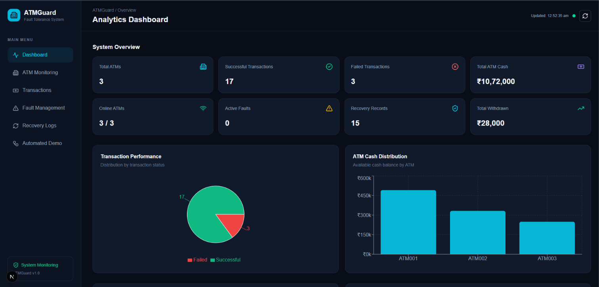
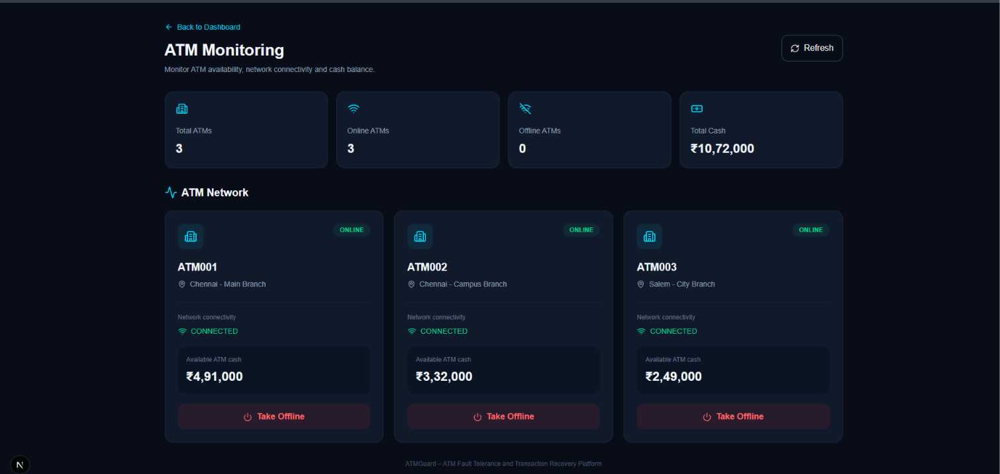
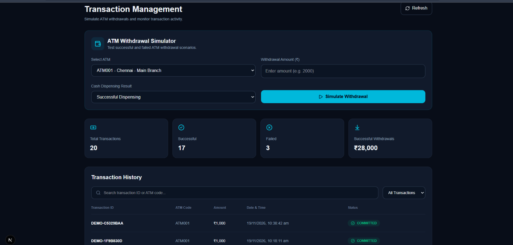
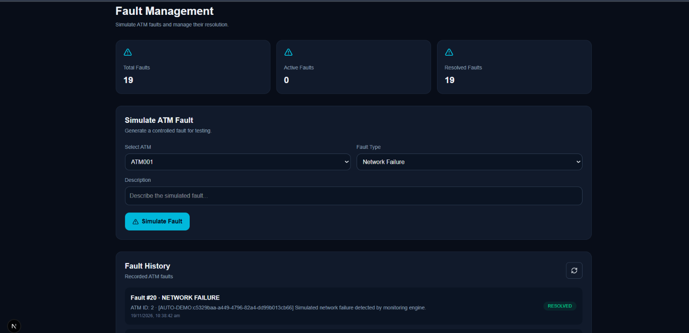
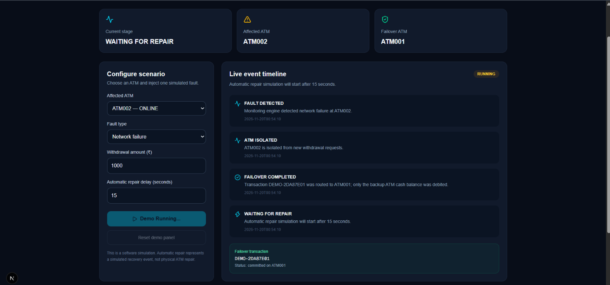
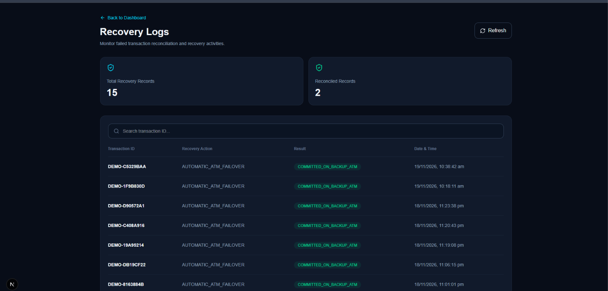

# ATMGuard – ATM Fault Tolerance and Transaction Recovery System

## Project Overview

ATMGuard is a full-stack web application designed to demonstrate fault tolerance and transaction recovery in ATM systems.

The system simulates ATM failures, detects and isolates faults, performs backup ATM failover when possible, and demonstrates automated recovery.

The main objective is to improve ATM service reliability and demonstrate how transactions can be handled during system failures.

## Key Features

- **ATM Monitoring:** Monitor ATM availability, network connectivity and cash balance.
- **Fault Simulation:** Simulate network, power and dispenser failures.
- **Fault Detection:** Identify and record ATM faults.
- **Fault Isolation:** Isolate affected ATMs from transaction processing.
- **Backup ATM Failover:** Route eligible transactions to another healthy ATM.
- **Automated Recovery:** Simulate fault repair after a configurable delay.
- **Transaction Management:** Simulate withdrawals and maintain transaction history.
- **Transaction Recovery:** Record and reconcile failed transactions.
- **Electronic Journal:** Maintain records of important ATM events.
- **Dashboard:** View ATM status, transactions, faults and recovery information.

## Fault Types

| Fault Type | Description |
|---|---|
| Network Failure | ATM network connection is disconnected |
| Power Failure | ATM becomes unavailable |
| Dispenser Failure | Cash dispensing failure is simulated |

## Fault-Tolerance Workflow

1. A fault is introduced into an ATM.
2. The system detects and records the fault.
3. The affected ATM is isolated from eligible transaction processing.
4. The system attempts to select a healthy backup ATM.
5. The automated recovery process simulates repair after the configured delay.
6. The ATM status and fault records are updated.

## System Architecture

```text
             USER
               |
               v
        NEXT.JS FRONTEND
               |
               v
         FASTAPI BACKEND
               |
       +-------+-------+
       |       |       |
       v       v       v
      ATM    FAULT   TRANSACTION
    MODULE  MODULE    MODULE
       |       |       |
       +-------+-------+
               |
               v
         MYSQL DATABASE
               |
       +-------+-------+
       |       |       |
       v       v       v
     ATM    FAULT   RECOVERY
     DATA   LOGS      LOGS
```

## Technology Stack

| Component | Technology |
|---|---|
| Frontend | Next.js, React, TypeScript |
| Styling | Tailwind CSS |
| Charts | Recharts |
| Icons | Lucide React |
| Backend | Python, FastAPI |
| Database | MySQL |
| ORM | SQLAlchemy |
| API | REST API |

## Project Structure

```text
ATMGuard/
│
├── backend/
│   └── app/
│       ├── __init__.py
│       ├── database.py
│       ├── main.py
│       └── main_backup.py
│
├── frontend/
│   ├── app/
│   │   ├── atms/
│   │   ├── demo/
│   │   ├── faults/
│   │   ├── recovery/
│   │   ├── transactions/
│   │   ├── globals.css
│   │   ├── layout.tsx
│   │   └── page.tsx
│   ├── public/
│   └── package.json
│
├── .gitignore
└── README.md
```

## Installation and Setup

### Prerequisites

- Python 3.11
- Node.js and npm
- MySQL Server
- Git

### 1. Clone the Repository

```bash
git clone https://github.com/kabish22/ATMGuard.git
cd ATMGuard
```

### 2. Configure MySQL

Create the database:

```sql
CREATE DATABASE atmguard_db;
```

Configure the required tables and initial ATM records before starting the backend.

Required tables:

- atms
- transactions
- fault_logs
- recovery_logs
- electronic_journal

### 3. Backend Setup

Open a terminal in the project folder:

```powershell
cd backend
python -m venv venv
venv\Scripts\activate
```

Install dependencies:

```powershell
pip install fastapi uvicorn sqlalchemy pymysql python-dotenv pydantic
```

Create a `.env` file inside the `backend` folder:

```env
DB_USER=your_mysql_username
DB_PASSWORD=your_mysql_password
DB_HOST=localhost
DB_PORT=3306
DB_NAME=atmguard_db
```

Start the backend:

```powershell
uvicorn app.main:app --reload
```

Backend URL:

http://127.0.0.1:8000

API documentation:

http://127.0.0.1:8000/docs

### 4. Frontend Setup

Open another terminal:

```powershell
cd frontend
npm install
npm run dev
```

Frontend URL:

http://localhost:3000

## Application Modules

| Module | Function |
|---|---|
| Dashboard | Overall ATM network overview |
| ATM Monitoring | Monitor ATM status and cash balance |
| Transactions | Simulate withdrawals and view history |
| Fault Management | Simulate and manage ATM faults |
| Automated Demo | Demonstrate fault tolerance and recovery |
| Recovery Logs | View transaction recovery records |

## Testing Scenarios

- Successful ATM withdrawal.
- Network failure simulation.
- Power failure simulation.
- Dispenser failure simulation.
- Backup ATM failover when eligible.
- Automated recovery demonstration.
- Failed transaction recovery and journal recording.

## Limitations

- ATM faults are simulated through software.
- No physical ATM hardware is connected.
- Failover is simulated within the application and is not connected to a real banking network.
- Automated repair represents simulated recovery, not physical equipment repair.
- This project is intended for academic demonstration and is not a production banking system.

## Future Enhancements

- Machine learning-based fault prediction.
- Real-time monitoring and alerts.
- ATM hardware simulator integration.
- Enhanced transaction consistency and recovery.
- Role-based authentication and access control.

## Contributors

- Kabish Rajendran
- Sanjeev
- Mukesh

## GitHub Repository

https://github.com/kabish22/ATMGuard

## Application Screenshots

### Dashboard


### ATM Monitoring


### Transaction Management


### Fault Management


### Automated Demo


### Recovery Logs
